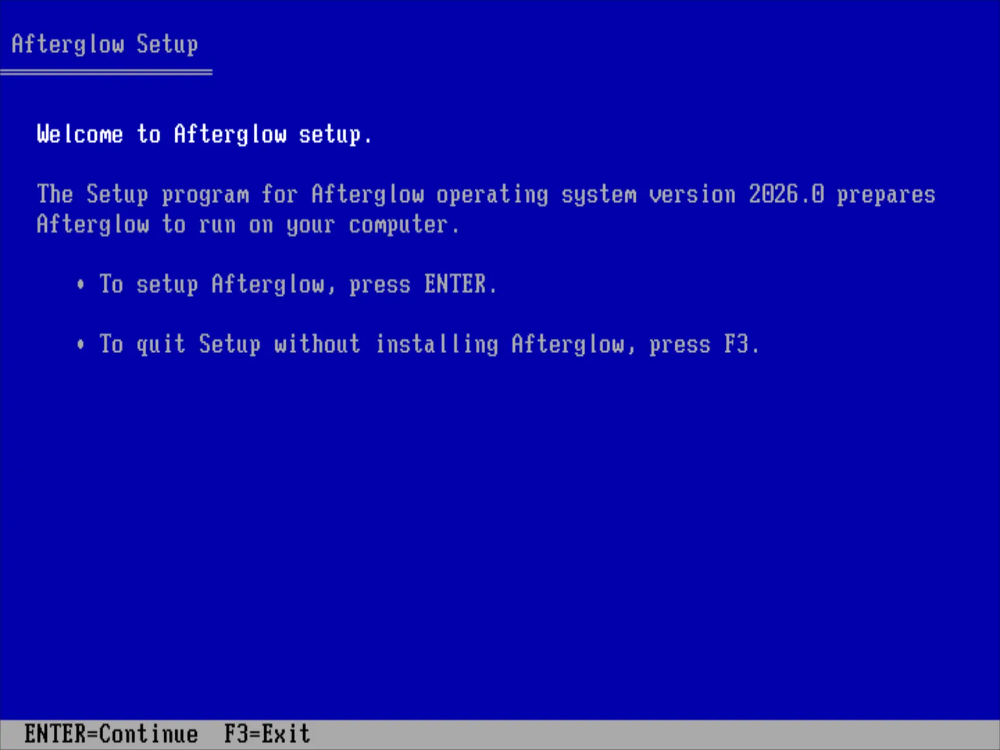

Afterglow Installer (setup.elf)
===

Installer for Afterglow, inspired by text-mode Windows NT installers.

Dependencies
---

### Build-time

- C compiler (that is compatible with C17)
- [S-Lang](https://www.jedsoft.org/slang/) and [Newt](https://gitlab.com/newt-ui/newt)
- [libxcrypt](https://github.com/besser82/libxcrypt)
- Python 3 (to generate data source for reserved user names)
- OpenSSL (optional, if using `-DUSE_BENCHMARK_TO_GUESS`)

### Run-time

- GNU tar (along with programs to handle gzip, xz, and zstd)
- e2fsprogs
- util-linux
- Coreutils or Busybox

Build Options
---

- `NDEBUG`, define to build for production. Setup would otherwise install to
  `/dev/loop0p1`.
- `USE_BENCHMARK_TO_GUESS`, use OpenSSL to estimate time required, use bogoMIPS
  otherwise (inaccurate).
    - You might want to use the inaccurate option (not setting this option) on
      ports with slower hardware (i486, for instance).

License
---

Afterglow Installer is licensed under [The GNU General Public License v3.0](https://www.gnu.org/licenses/gpl-3.0.en.html).
